# 基于SpringBoot与Vue的家教服务预约平台的设计与实现

> 本文围绕家教服务行业，构建了一套包含用户端、老师端和管理员端的预约平台，旨在解决家教信息不对称、预约流程繁琐、沟通效率低等问题。

## 一、项目背景

- 随着家长对课外辅导需求的增加，家教市场逐渐扩大，但传统家教信息获取渠道有限，缺乏统一管理平台。
- 用户难以快速找到合适的家教老师，老师也缺乏高效的接单渠道，双方沟通成本高。
- 平台通过移动端小程序和电脑管理后台的形式，提供家教老师展示、预约下单、在线沟通、订单管理、认证审核等功能，提升家教服务的匹配效率与管理规范化。

## 二、功能模块介绍

- 系统分为三个核心端：用户端（小程序）、老师端（小程序）、管理员端（电脑网页）。

| 角色 | 所属端 |
|------|--------|
| 用户（家长/学生） | 用户端（移动端小程序） |
| 家教老师 | 老师端（移动端小程序） |
| 平台管理员 | 管理员端（电脑网页） |

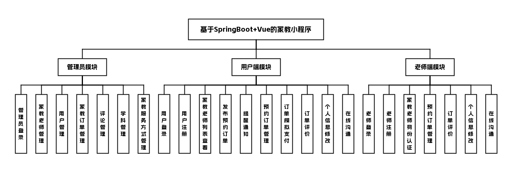

## 三、技术栈说明

**前端**：Vue

**后端**：SpringBoot、JAVA

**数据库与中间件**：Mysql

## 四、核心模块介绍

###### 用户端（移动端小程序）

###### 用户

| 功能点 | 描述 |
|--------|------|
| 用户登录注册 | 支持手机号或账号密码方式 |
| 家教老师列表 | 查看平台中所有的家教老师 |
| 发布预约订单 | 选择家教老师，填写课程、时间、授课方式 |
| 提醒通知 | 发布订单后通过邮件提醒对应老师 |
| 订单管理 | 支持取消或修改已提交的预约订单 |
| 模拟支付 | 对订单进行模拟支付操作 |
| 订单评价 | 对完成的订单进行评价 |
| 个人信息修改 | 修改个人资料信息 |
| 在线沟通 | 与家教老师进行实时在线沟通 |

##### 界面展示

登录页：输入账号密码，登录家教平台

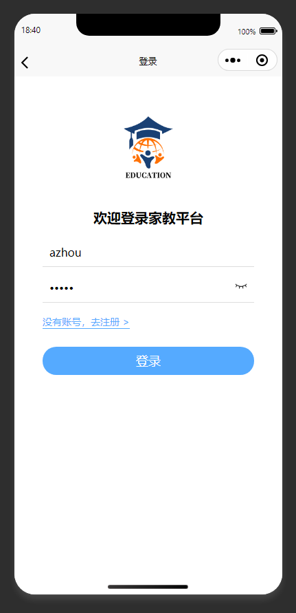

注册页：填写信息完成家教平台新账号注册

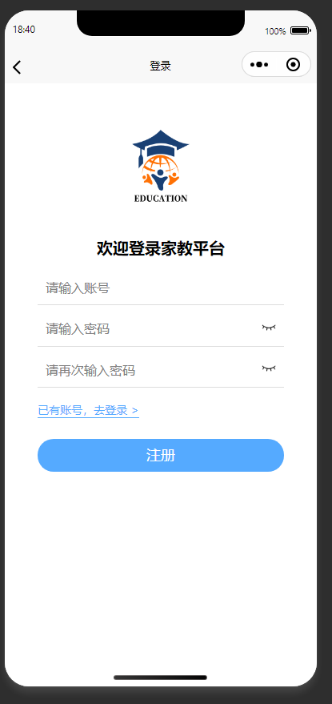

登录页：教师输入账号密码登录家教平台

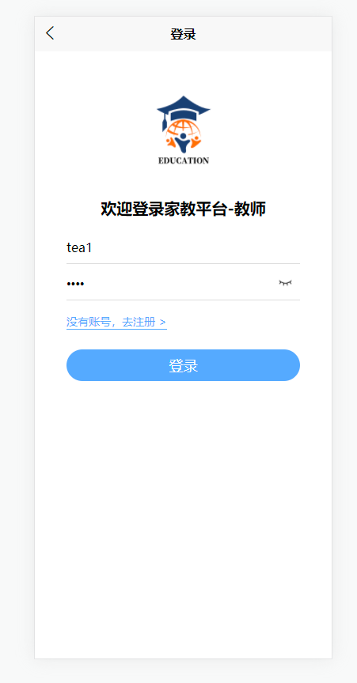

教师列表页：支持按条件筛选，查看平台家教老师信息

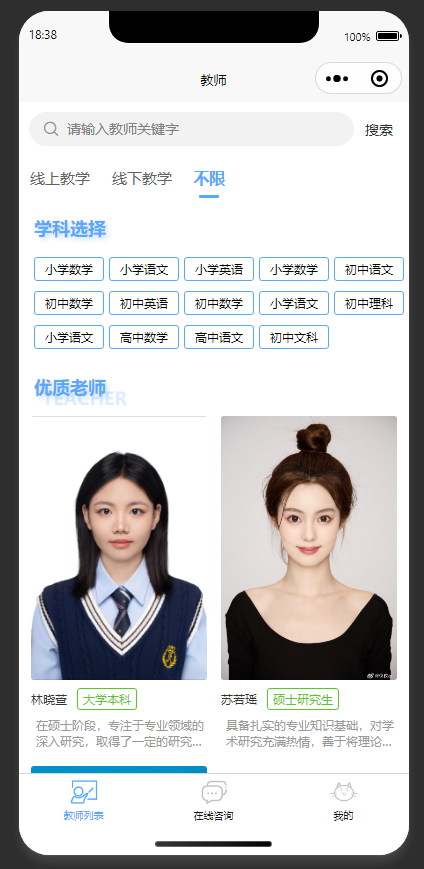

详情页：展示家教老师详细信息，支持预约与咨询

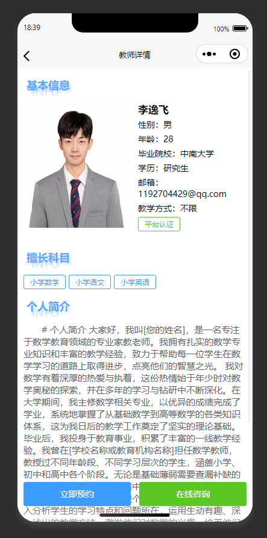

预约订单发布页：用户填写预约家教老师的相关订单信息

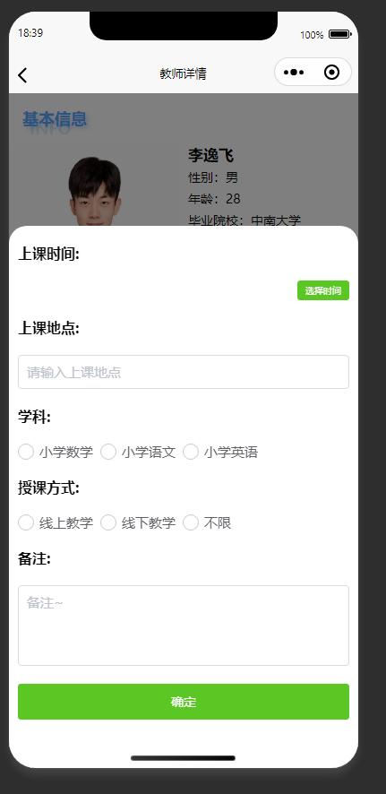

订单管理页：查看个人的家教课程预约订单记录

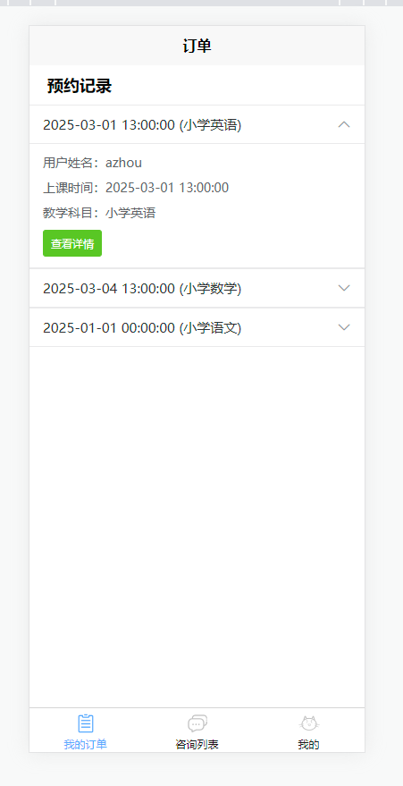

订单管理页：查看家教预约订单的详细信息

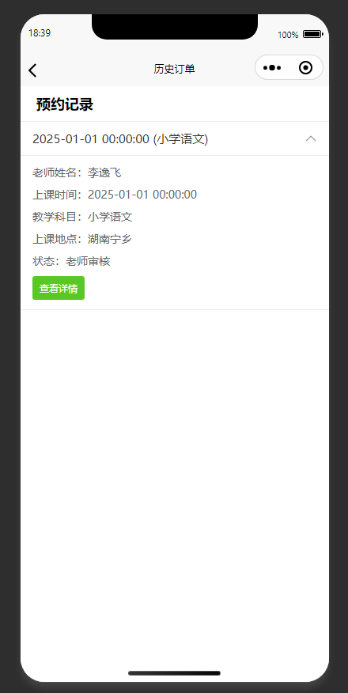

订单详情页：查看家教预约订单详情，支持评论和在线沟通

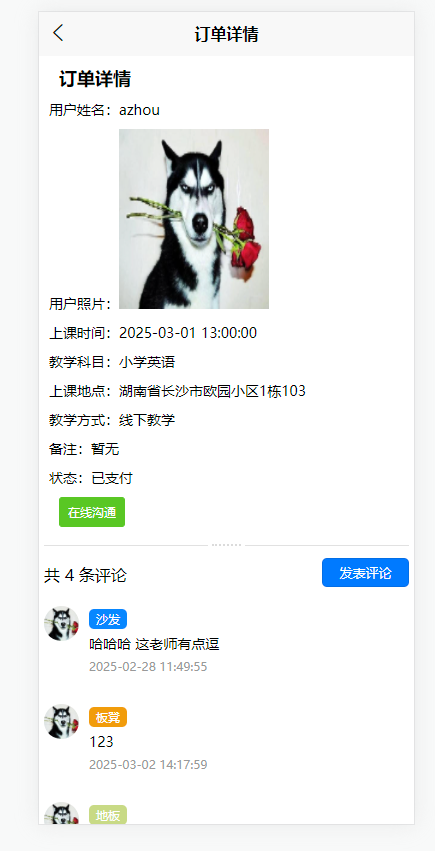

订单详情页：查看家教预约订单详情，可咨询取消与评论

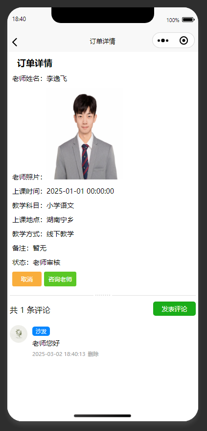

个人中心页：展示个人功能入口，供用户操作个人相关业务

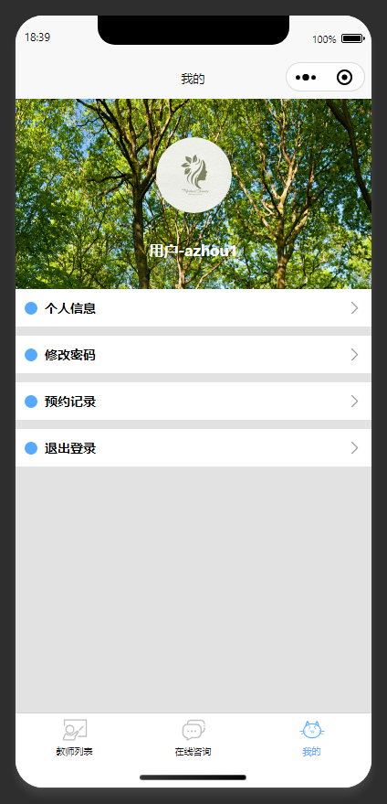

个人中心页：展示个人信息，提供个人相关功能入口

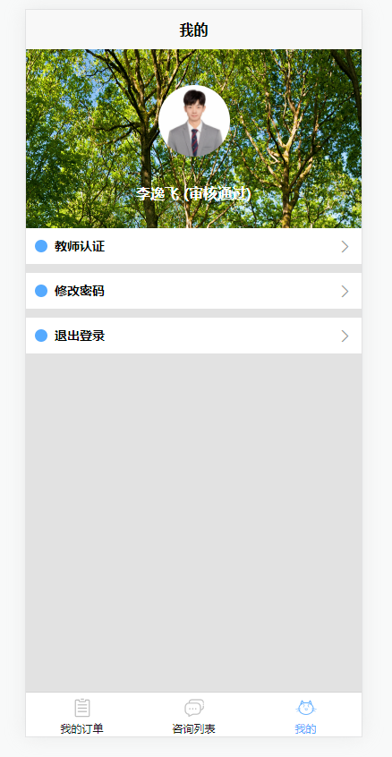

身份认证页：修改认证信息，提交教师身份认证申请

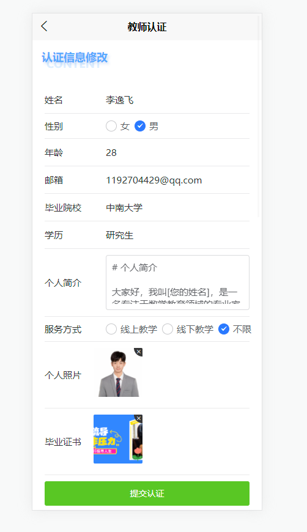

咨询列表页：展示在线咨询的会话列表

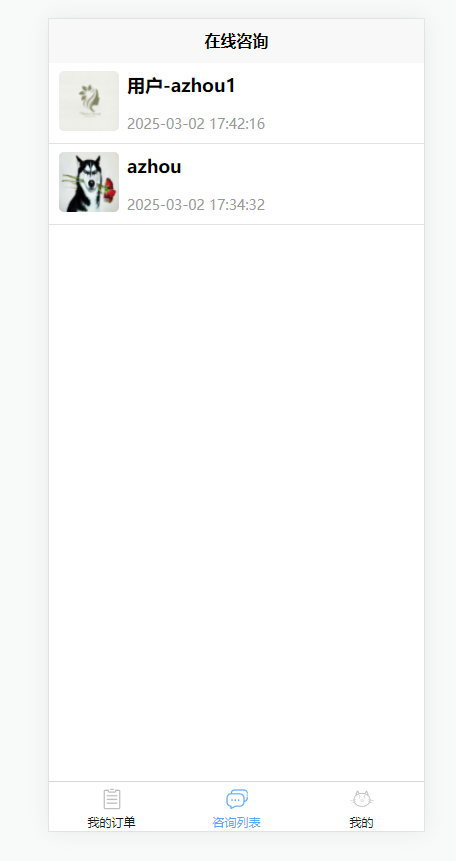

在线咨询页：展示在线咨询页面，显示对接的咨询老师信息

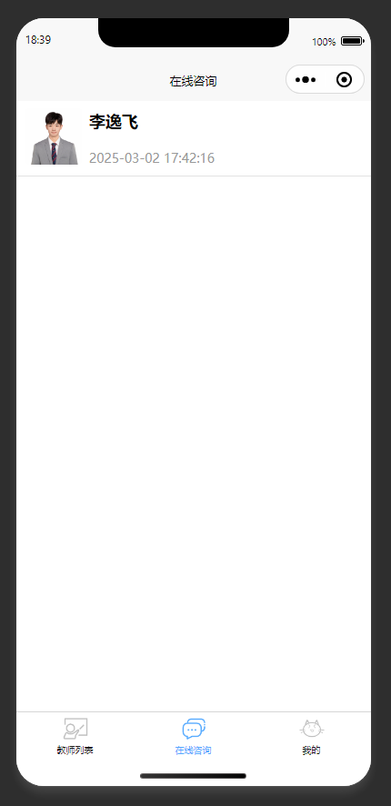

在线沟通页：家长与家教老师进行在线文字沟通

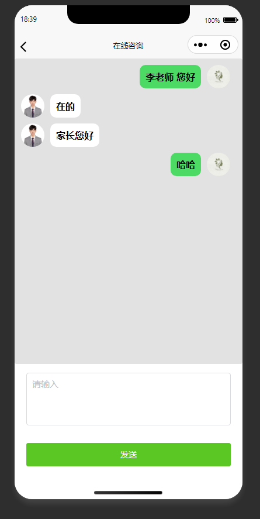

在线沟通页：家长和家教老师进行在线文字沟通

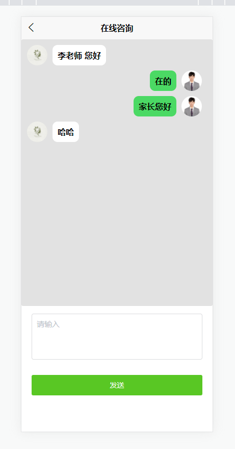

###### 老师端（移动端小程序）

###### 家教老师

| 功能点 | 描述 |
|--------|------|
| 老师登录注册 | 支持手机号或账号密码方式 |
| 身份认证 | 提交相关学历信息，由管理员进行认证审核 |
| 预约管理 | 对用户提交的家教预约订单进行确定或拒绝 |
| 订单评价 | 查看用户对自己订单的评价 |
| 个人信息修改 | 修改个人资料信息 |
| 在线沟通 | 与用户进行实时在线沟通 |

##### 界面展示

登录页：输入账号密码，登录家教平台

注册页：填写信息完成家教平台新账号注册

登录页：教师输入账号密码登录家教平台

教师列表页：支持按条件筛选，查看平台家教老师信息

详情页：展示家教老师详细信息，支持预约与咨询

预约订单发布页：用户填写预约家教老师的相关订单信息

订单管理页：查看个人的家教课程预约订单记录

订单管理页：查看家教预约订单的详细信息

订单详情页：查看家教预约订单详情，支持评论和在线沟通

订单详情页：查看家教预约订单详情，可咨询取消与评论

个人中心页：展示个人功能入口，供用户操作个人相关业务

个人中心页：展示个人信息，提供个人相关功能入口

身份认证页：修改认证信息，提交教师身份认证申请

咨询列表页：展示在线咨询的会话列表

在线咨询页：展示在线咨询页面，显示对接的咨询老师信息

在线沟通页：家长与家教老师进行在线文字沟通

在线沟通页：家长和家教老师进行在线文字沟通

###### 管理员端（电脑网页）

###### 平台管理员

| 功能点 | 描述 |
|--------|------|
| 管理员登录 | 后台管理账号登录 |
| 家教老师管理 | 对老师提交的身份认证信息进行审核 |
| 用户管理 | 管理平台注册用户 |
| 订单管理 | 管理所有家教预约订单 |
| 评论管理 | 对不当言论评论进行屏蔽 |
| 学科管理 | 管理平台支持的学科类别 |
| 家教服务方式管理 | 管理可选的授课方式（如线上、线下等） |

##### 界面展示

登录页：管理员输入账号密码登录家教管理后台

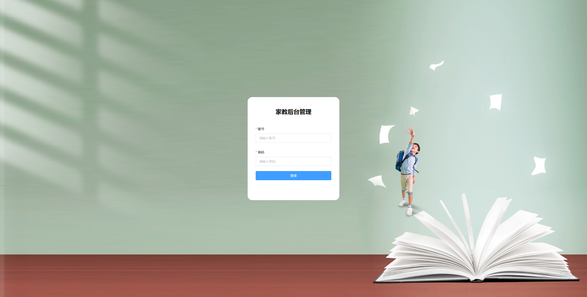

教师管理页：展示教师列表，对家教老师进行审核管理

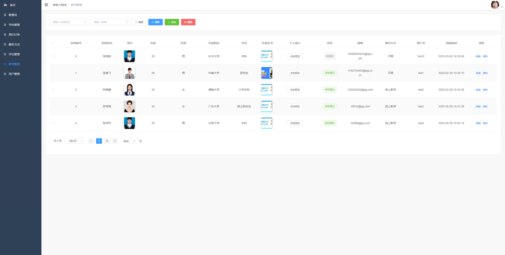

订单管理页：查看并管理平台所有家教预约订单

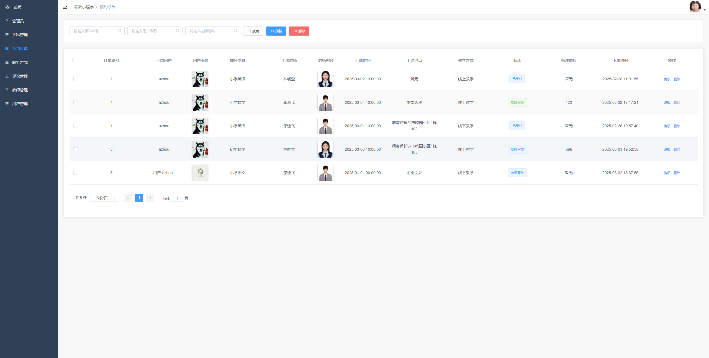

评论管理页：展示用户评论，对不当评论进行管理操作

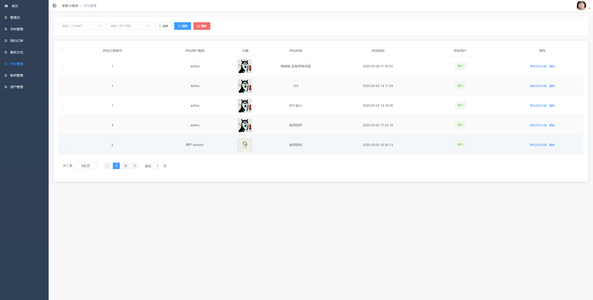

学科管理页：对家教平台的学科信息进行管理

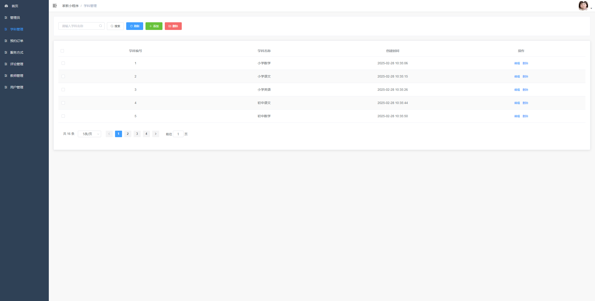

服务方式管理页：管理家教服务方式，支持增删改操作

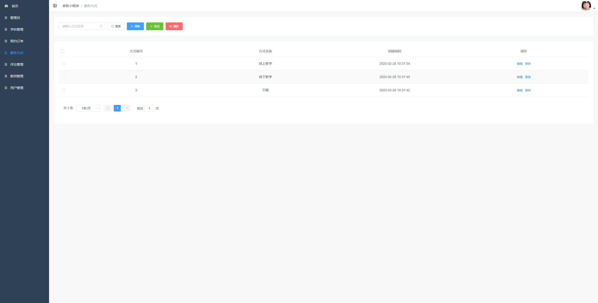

## 五、主要业务流程

1. 用户通过小程序注册登录，浏览家教老师列表。
2. 用户选择心仪的家教老师，填写课程、时间、授课方式，提交预约订单。
3. 系统通过邮件通知对应的家教老师。
4. 家教老师在小程序端确认或拒绝该预约订单。
5. 用户对已确认的订单进行模拟支付。
6. 订单完成后，用户和老师可相互进行评价。
7. 管理员通过电脑后台对老师认证信息、用户、订单、评论等进行统一管理。

## 六、项目拓展性

- 可增加在线视频授课功能，拓展线上实时教学场景。
- 可引入信用评分体系，提升平台交易安全与用户信任度。
- 可对接真实支付渠道，支持微信、支付宝等主流支付方式。
- 可增加智能推荐算法，根据用户历史行为推荐匹配的家教老师。
- 可开发PC端网页版，兼容更多使用场景。

## 代码说明 
本仓库为项目的 **后端核心代码部分** 主要用于展示系统的业务设计思路与后端实现方式 出于学习展示与版权保护考虑 前端实现、完整数据库脚本及部署配置未在本仓库中公开 

##  项目交流 
本项目用于学习展示 如需项目完整功能演示、答辩说明或技术交流 请前往作者 GitHub 主页查看联系方式